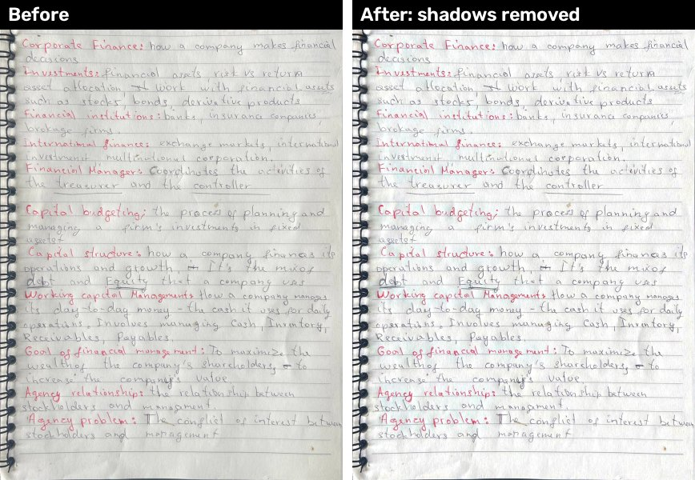
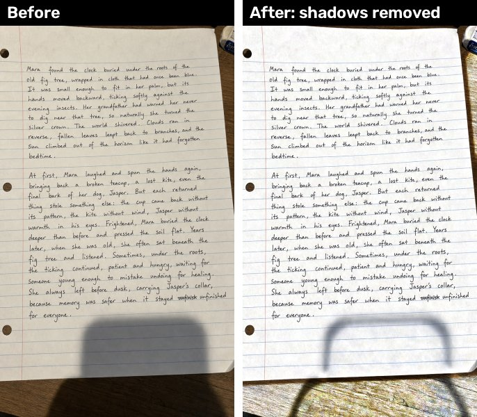
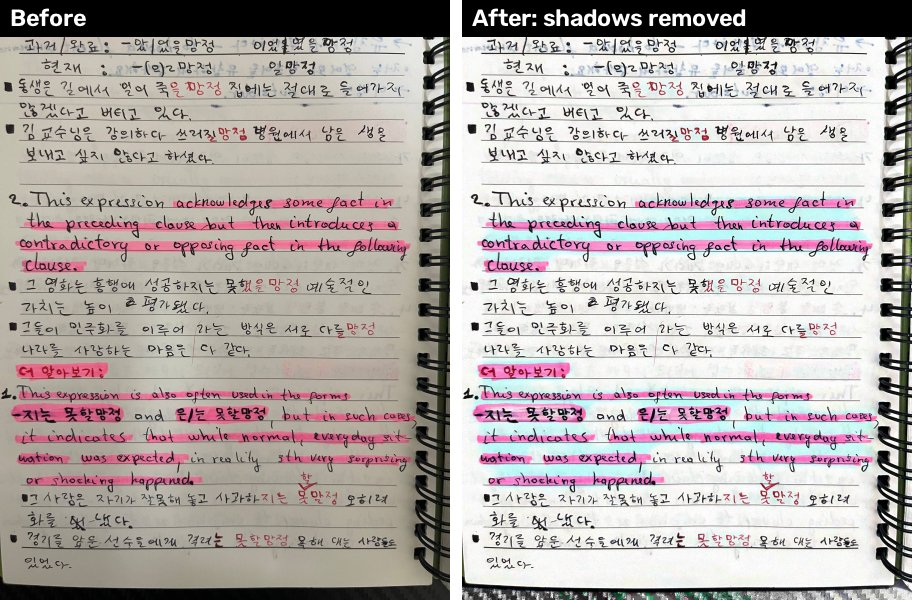

# OpenCV Notes Vision

Preprocessing pipeline that turns phone photos of handwritten notes into clean,
flat page images, before they are sent to an AI model to generate flashcards
for [Brainmaxx](https://github.com/studiousdoston/Personal_Study_App-).

## Step 4: Page detection + perspective flattening

**How it works:** Otsu thresholding separates the bright page from the desk,
morphology cleans the mask, a convex hull finds 4 corners, and a perspective
transform flattens the full-resolution image.

**Problems solved along the way:**

- **Textured desk** (carbon-fiber pattern): Canny edge detection picked up the
  texture, so I switched to thresholding, which ignores it.
- **Spiral binding:** the rings made the outline jagged; a convex hull smooths
  over them before finding the corners.
- **False positives on cropped images:** already-cropped scans were being
  "detected" and partly cut off; fixed by requiring the page not to touch the
  image border.

## Step 5: Shadow removal + contrast

**How it works:** the paper background is estimated by "erasing" the ink
(dilate + median blur on a quarter-size copy), then each color channel is
divided by it. Shadows cancel out, the paper becomes evenly white, and ink keeps
its color. A gamma curve then darkens faint ink without greying the paper.

**Design decision:** I first planned CLAHE (adaptive histogram equalization),
but for documents it also boosts paper texture and grid lines. Background
division only removes lighting differences, so grid lines stay light and colors
are preserved, which the planned highlighter-detection feature needs.
