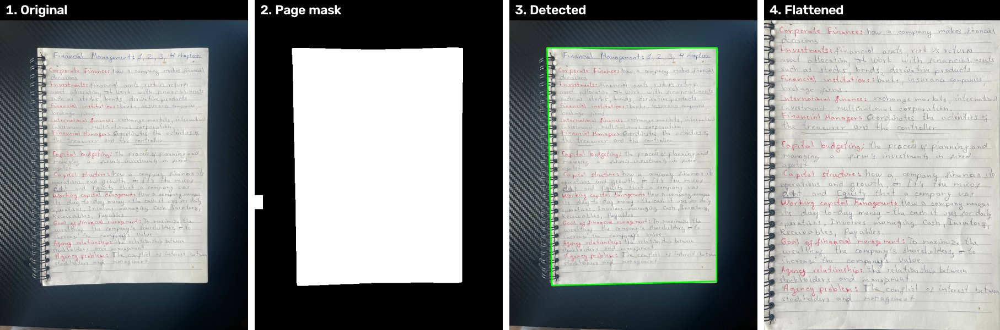

# OpenCV Notes Vision

Preprocessing pipeline that turns phone photos of handwritten notes into clean,
flat page images, before they are sent to an AI model to generate flashcards
for [Brainmaxx](link-to-brainmaxx-repo).

## Step 4: Page detection + perspective flattening

**How it works:** Otsu thresholding separates the bright page from the desk,
morphology cleans the mask, a convex hull finds 4 corners, and a perspective
transform flattens the full-resolution image.

**Problems solved along the way:**

- **Textured desk** (carbon-fiber pattern): Canny edge detection picked up the
  texture, so I switched to thresholding, which ignores it.
- **Spiral binding:** the rings made the outline jagged; a convex hull smooths
  over them before finding the corners.
- **False positives on cropped images:** already-cropped scans were being
  "detected" and partly cut off; fixed by requiring the page not to touch the
  image border.
