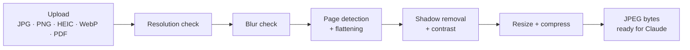
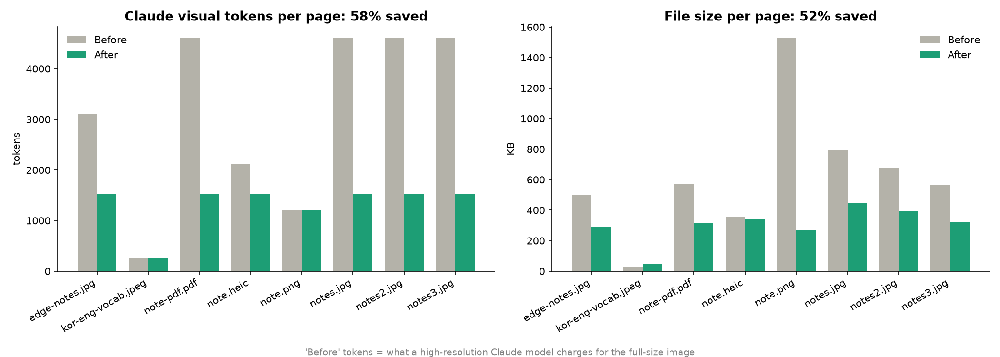

# OpenCV Notes Vision

A computer-vision preprocessing pipeline that turns phone photos of handwritten
notes into clean, flat, AI-ready page images.

It is the first stage of the **notes → flashcards** feature in
[Brainmaxx](https://github.com/studiousdoston/Personal_Study_App-), my spaced-repetition
study app: photograph a page of notes, and the cleaned image is sent to Claude to
generate flashcards.


## Why preprocessing?

Claude can already read handwriting, so OpenCV's job here is **not** OCR. It is to
**prepare** each page so the AI gets the best possible input at the lowest cost:

- reject photos that are too small or blurry **before** paying for an API call
- find the page in the photo and flatten it if it was taken at an angle
- remove shadows and uneven lighting while keeping ink colors
- resize and compress to fit the model's vision limits

**Result on my sample set: 58% fewer AI tokens and 52% smaller files per page.**

## Pipeline



## Usage

```bash
python -m venv venv
source venv/bin/activate
python -m pip install -r requirements.txt

python cli.py samples/*            # process files, save cleaned pages to output/cli
python cli.py notes.heic --json    # also write a report.json
python cli.py --help
```

Example output:

```
✓ edge-notes.jpg p1              914x1281   1518 tokens  (flattened)
✗ kor-eng-vocab.jpeg p1        image too small, use a higher-resolution photo
✓ notes.jpg p1                   941x1255   1530 tokens  (kept as-is)
----------------------------------------------------------------------
7/8 pages ready · 10355 tokens total · saved to output/cli
```

From Python (this is what the Brainmaxx backend will call):

```python
from vision.pipeline import process_file

results = process_file(uploaded_bytes)   # one PageResult per page
for page in results:
    if page.ok:
        send_to_claude(page.jpeg)
    else:
        print(page.status)               # "too_small" or "blurry"
```

## How each step works

### 1. Loading any file type

`vision/loader.py` turns any upload into a list of OpenCV images (one per page).

- **Content-based type detection:** the file type is read from its first bytes
  ("magic bytes"), not its extension. During testing, two sample "PDFs" turned out
  to be a renamed JPEG and a WebP; trusting the extension would have crashed.
- **HEIC support** for iPhone photos via `pillow-heif`.
- **EXIF rotation:** phone photos are stored sideways with a "rotate me" tag; it is
  applied so pages are upright.
- **PDF rendering** with PyMuPDF, capped at 2500px on the longest side. A PDF
  created from a photo had a poster-sized page that rendered at 38 megapixels;
  the cap keeps memory safe on a server.

### 2. Quality checks

`vision/quality.py` rejects pages early, before any heavy processing or API cost.

- **Resolution:** the shorter side must be at least 600px.
- **Blur:** variance of the Laplacian, measured at a fixed 1000px width so scores
  are comparable across image sizes. The threshold (250) was tuned on real samples:
  sharp photos scored 923–2902, a mildly blurred copy ~173, heavy blur ~15.

### 3. Page detection + perspective flattening

`vision/page.py`

**How it works:** Otsu thresholding separates the bright page from the desk,
morphology cleans the mask, a convex hull finds 4 corners, and a perspective
transform flattens the full-resolution image.

**Problems solved along the way:**

- **Textured desk** (carbon-fiber pattern): Canny edge detection picked up the
  texture, so I switched to thresholding, which ignores it.
- **Spiral binding:** the rings made the outline jagged; a convex hull smooths
  over them before finding the corners.
- **False positives on cropped images:** already-cropped scans were being
  "detected" and partly cut off; fixed by requiring the page not to touch the
  image border. Those images are now kept as-is.

### 4. Shadow removal + contrast

`vision/enhance.py`


**How it works:** the paper background is estimated by "erasing" the ink
(dilate + median blur on a quarter-size copy), then each color channel is
divided by it. Shadows cancel out, the paper becomes evenly white, and ink keeps
its color. A gamma curve then darkens faint ink without greying the paper.

**Design decision:** I first planned CLAHE (adaptive histogram equalization),
but for documents it also boosts paper texture and grid lines. Background
division only removes lighting differences, so grid lines stay light and colors
are preserved, which the planned highlighter-detection feature needs.

### 5. Resize + compress for the AI model

`vision/compress.py`

Pages are resized to fit Claude's standard-tier vision limits
(1568px long edge **and** 1568 visual tokens, where tokens = ⌈w/28⌉ × ⌈h/28⌉),
then encoded as JPEG quality 85.



| Metric (8 sample pages) | Before   | After    | Saved   |
| ----------------------- | -------- | -------- | ------- |
| Visual tokens\*         | 25,088   | 10,621   | **58%** |
| File size               | 5,015 KB | 2,428 KB | **52%** |

\*"Before" = tokens a high-resolution model would charge for the full-size image.

**Lesson learned:** my first version only limited the long edge, which still
produced ~2,300-token pages. Claude's standard tier caps tokens too, so the
resize now shrinks until both limits fit.

## Project structure

```
notes-vision/
├── vision/                  # the pipeline (pure functions, no app code)
│   ├── loader.py            # any file → list of page images
│   ├── quality.py           # resolution + blur checks
│   ├── page.py              # page detection + perspective flattening
│   ├── enhance.py           # shadow removal + contrast
│   ├── compress.py          # resize + JPEG encoding, token estimate
│   └── pipeline.py          # process_file(): runs every step
├── cli.py                   # command-line tool + report
├── make_showcase.py         # generates the README showcase images
├── make_savings_chart.py    # generates the savings chart
├── test_*.py                # per-step test scripts
└── docs/showcase/           # images used in this README
```

## Known limitations

- **Page detection needs contrast:** it works best with a light page on a darker
  surface and some background visible on all sides. Otherwise the image is kept
  as-is (not rejected).
- **Rotation without EXIF:** screenshots and web images have no rotation tag, so
  sideways pages stay sideways. In Brainmaxx, Claude reports the rotation and the
  review screen has a rotate button.
- **Small test set:** thresholds were tuned on a handful of my own photos and
  public samples; they will be re-checked as more real photos come in.

## Tech stack

Python · OpenCV · NumPy · Pillow + pillow-heif · PyMuPDF · matplotlib

## Roadmap

- [x] Phase 0: standalone OpenCV pipeline + CLI (this repo)
- [ ] Phase 1: integrate into the Brainmaxx FastAPI backend
- [ ] Phase 2: Claude vision call that turns pages into draft flashcards
- [ ] Phase 3: upload + review screen in the Brainmaxx frontend
- [ ] Later: highlighter → cards (HSV color segmentation), diagram cards (image occlusion)
- [ ] Optional: benchmark PaddleOCR vs Claude on mixed Korean/English handwriting
